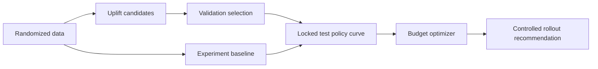

# Campaign Uplift Optimizer

[](https://github.com/smAsifHossain/campaign-uplift-optimizer/actions/workflows/ci.yml)
[](https://smAsifHossain.github.io/campaign-uplift-optimizer/)
[](https://www.python.org/)
[](LICENSE)

**Which customers should receive advertising because it changes their behavior—and how should a
limited campaign budget be allocated?**

This project builds a reproducible causal decision system on randomized advertising data. It
compares uplift modeling with ordinary conversion propensity and random targeting, selects models
without test leakage, quantifies uncertainty, and translates incremental effects into explicit
business scenarios.

**Live decision app:** <https://smAsifHossain.github.io/campaign-uplift-optimizer/>

## Why this is a data science project

The repository demonstrates the parts of data science that a prediction-only notebook misses:

- Randomized experiment analysis and statistical uncertainty
- Heterogeneous treatment-effect modeling
- Validation-only model and policy selection
- Locked-test policy evaluation using transformed outcomes
- Conversion propensity versus true incrementality
- Business optimization under explicit assumptions
- Reproducible acquisition, tests, CI, and deployment
- Clear limitations and responsible rollout guidance

## Decision workflow



## Published evidence

The canonical machine-readable result is [`artifacts/results.json`](artifacts/results.json). The
human decision memo is [`artifacts/executive-summary.md`](artifacts/executive-summary.md). Both are
generated by the pipeline; the dashboard does not contain hand-entered performance claims.

### Actual portfolio run

The published run scanned all **13,979,592** source rows and drew a seeded 10% sample of
**1,398,296** observations. Model selection used 279,362 validation rows; final reporting used a
separate 280,149-row grouped test set.

- Randomized average treatment effect: **+0.099 percentage points**
  (95% CI **+0.049 to +0.148**, two-sided p = 0.00010)
- Selected causal candidate: **regularized linear T-learner**
- At 20% reach: **901.8 estimated incremental conversions per 1,000,000 eligible customers**
- Uplift minus random at equal reach: **+0.613 conversions per 1,000 eligible**
  (95% CI **+0.179 to +1.048**)
- Uplift minus propensity at equal reach: **−0.047 conversions per 1,000 eligible**
  (95% CI **−0.139 to +0.044**), so there is **no clear winner** between those two policies
- Default economic scenario: **$92,211 estimated profit**, using explicitly assumed values of
  $0.08 per contact and $120 per incremental conversion

The honest recommendation is a controlled head-to-head experiment between uplift and propensity
targeting at equal reach, with a permanent random holdout. The project does not claim that uplift
beat propensity or that the scenario profit was realized.

> Monetary outputs are scenarios based on user-supplied contact cost and conversion value. The
> source data contain neither revenue nor campaign cost, so this project does not claim historical
> savings or deployed business impact.

## Repository structure

```text
src/campaign_uplift/   acquisition, splitting, modeling, evaluation, optimization
tests/                 synthetic unit and integration tests
artifacts/             generated aggregate results and executive memo
site/                  buildless GitHub Pages application
docs/                  methodology, architecture, and model card
data/                  source documentation; raw data are gitignored
.github/workflows/     CI and artifact-based Pages deployment
```

## Reproduce the analysis

Requirements: Python 3.12 and approximately 2 GB of free disk space for the source archive,
sample, dependencies, and temporary files.

```bash
python -m venv .venv
# Windows PowerShell: .venv\Scripts\Activate.ps1
# macOS/Linux: source .venv/bin/activate

python -m pip install -r requirements.lock
python -m pip install --no-deps -e .

campaign-uplift acquire
campaign-uplift run --sample-fraction 0.10 --build-site
pytest
ruff check .
```

For a fast pipeline check on real data:

```bash
campaign-uplift run --smoke
```

Synthetic development is always explicit:

```bash
campaign-uplift run --synthetic --synthetic-rows 30000 --build-site
```

The deployed portfolio must have `status: portfolio_real_data` in its result artifact. A synthetic
build displays a visible warning and is never silently presented as a finding.

## Methods

- Dataset: corrected Criteo Uplift Prediction Dataset v2.1
- Primary outcome: conversion
- Split: stable feature-vector hash, 60% train / 20% validation / 20% test
- Causal candidates: logistic T-learner, boosted T-learner, boosted S-learner
- Predictive baseline: conversion propensity
- Policy metrics: incremental conversions, AUUC above random, rank-group calibration
- Decision rule: select model and default reach on validation; report once on locked test

See the full [`methodology`](docs/methodology.md), [`architecture`](docs/architecture.md), and
[`model card`](docs/model-card.md).

## Data licensing

The source code is MIT licensed. The Criteo dataset is separately licensed CC BY-NC-SA 4.0 and is
not redistributed. Review [`DATA_LICENSE.md`](DATA_LICENSE.md) before acquiring or using the data.

## Author

S M Asif Hossain
