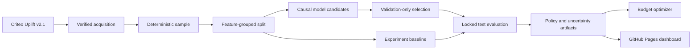

# Architecture

## Design decisions

- **Raw data stay local.** The archive is too large for normal Git and carries a separate
  non-commercial dataset license.
- **Identical covariates stay together.** A stable hash split prevents duplicate feature vectors
  from leaking across train, validation, and test sets.
- **Validation selects; test reports.** The final test set never chooses a model or reach.
- **Policy value is the target.** Models are compared using randomized holdout policy curves and
  AUUC above random, not ordinary classification accuracy.
- **The website is static.** GitHub Pages receives only HTML, CSS, JavaScript, and aggregate JSON.
  There is no server, secret, or runtime dependency.
- **Deployments do not create commits.** GitHub Actions uploads a Pages artifact instead of
  writing a bot-authored `gh-pages` branch.
